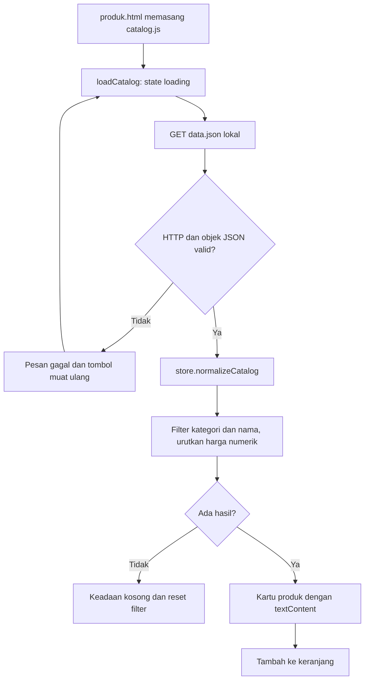
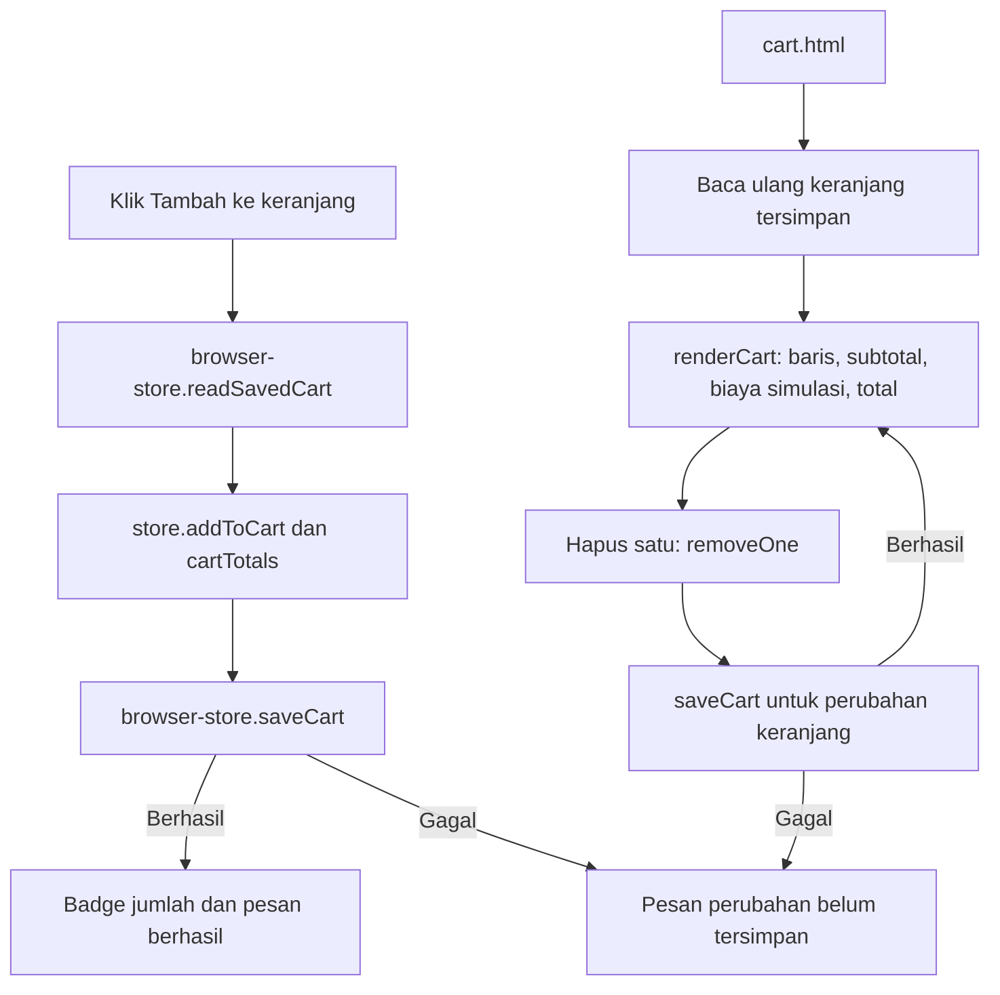

# Alur Kopi Kuy Web

## Halaman dan sumber data

[index.html](../index.html) adalah halaman kedai statis. Tautan Shop membuka [produk.html](../produk.html), yang memasang modul [js/catalog.js](../js/catalog.js). Tautan keranjang membuka [cart.html](../cart.html) dan modul [js/cart.js](../js/cart.js). Navigasi Bootstrap memakai bundle lokal; logika katalog/keranjang memakai ES modules tanpa jQuery.

[data.json](../data.json) berisi contoh produk yang dikelompokkan menurut kategori. loadCatalog memeriksa response.ok, lalu [normalizeCatalog](../js/store.js) menormalisasi nama/gambar/harga, melewati baris tidak valid dan menghapus identitas produk ganda. Identitas memakai gabungan nama, foto dan harga; harga yang berbeda tetap merupakan identitas berbeda.

Pencarian, kategori dan urutan harga diterapkan bersama pada array produk di memori. Hasil kosong menampilkan Reset pencarian; reset mengembalikan seluruh filter dan fokus pencarian. Kegagalan fetch menyediakan percobaan ulang. Aplikasi tidak mengambil katalog dari API kopi lama saat runtime.

## Tambah, simpan dan hapus satu

[browser-store.js](../js/browser-store.js) membaca/menulis key `list_belanja` di localStorage. JSON bukan array atau storage yang tidak dapat dibaca menghasilkan keranjang kosong dengan pemberitahuan. [normalizeCart](../js/store.js) melewati baris tidak sah, menggabungkan duplikat dan mempertahankan jumlah maksimal 999 per identitas; format lama tanpa qty dianggap satu barang.

Tambah membaca kembali isi storage sebelum perubahan. Produk yang sama menaikkan qty; penambahan di atas batas ditolak. Di halaman keranjang, Hapus satu mengurangi qty dan menghapus baris ketika jumlah mencapai nol. Operasi UI mengumumkan sukses setelah penyimpanan berhasil; kegagalan setItem ditampilkan sebagai gagal menyimpan.

[cartTotals](../js/store.js) menghitung subtotal rupiah bulat, jumlah unit, biaya simulasi 10% yang dibulatkan sekali, lalu total. Perkalian/penjumlahan di luar safe integer ditolak. Angka 10% mempertahankan aturan demo, bukan pernyataan aturan pajak saat ini.

Event storage dari tab lain memperbarui badge pada katalog dan merender ulang keranjang. Sinkronisasi ini berlaku pada origin/storage browser yang sama, bukan akun atau perangkat lain.

## Render dan batas penggunaan

Nama/keterangan masuk DOM melalui textContent. setProductImage pada [browser-store.js](../js/browser-store.js) memeriksa protokol HTTP/HTTPS dan memakai logo lokal bila URL/gambar gagal. Keranjang kosong memberi tautan kembali ke katalog.

Tidak ada backend, akun, checkout pembayaran atau pesanan server. localStorage dapat diedit pengguna dan bukan data transaksi tepercaya. Halaman kedai masih mempunyai beberapa tautan/sematan eksternal yang disebutkan pada [README](../README.md); alur ini tidak mengirim pesan atau memproses transaksi melalui tautan tersebut.

## Pemeriksaan yang tersedia

[tests/store.test.js](../tests/store.test.js) mencakup harga, normalisasi, identitas/qty, hapus satu, total dan overflow. [tests/browser.spec.js](../tests/browser.spec.js) mencakup filter, simpan/reload, gagal fetch/retry, storage gagal, teks/URL tidak aman, perubahan tab dan viewport sempit. Dokumen ini berasal dari pembacaan sumber; tidak ada runtime atau tes baru yang dijalankan untuk perubahan dokumentasi.
